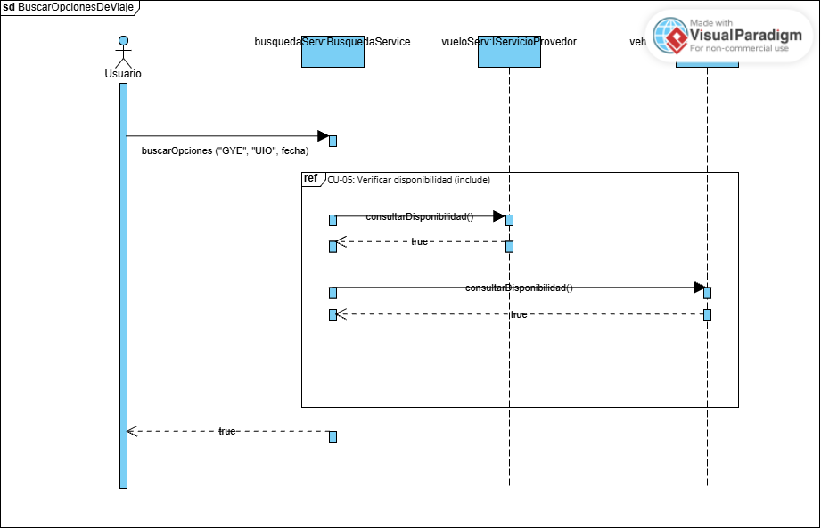
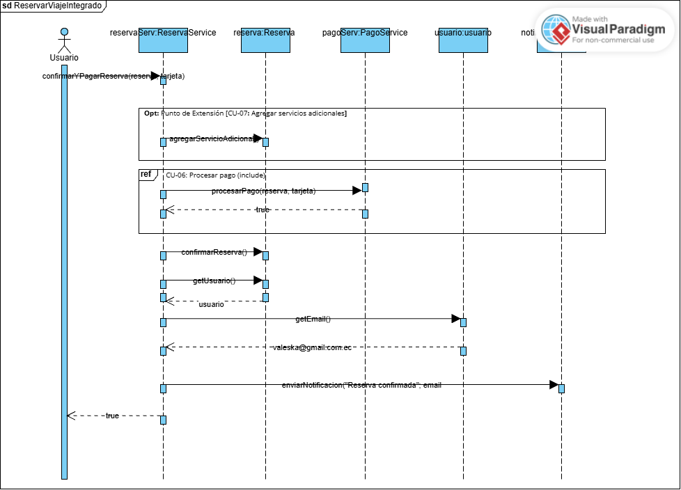
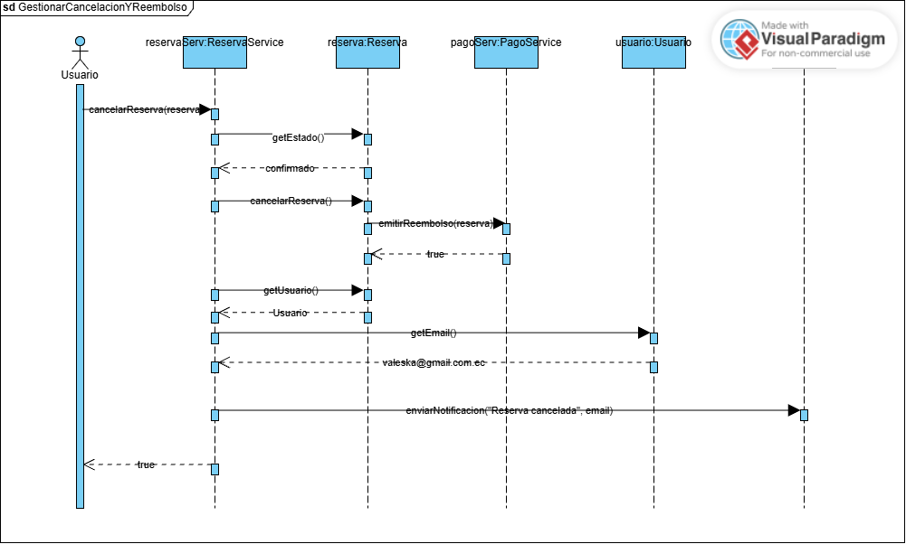
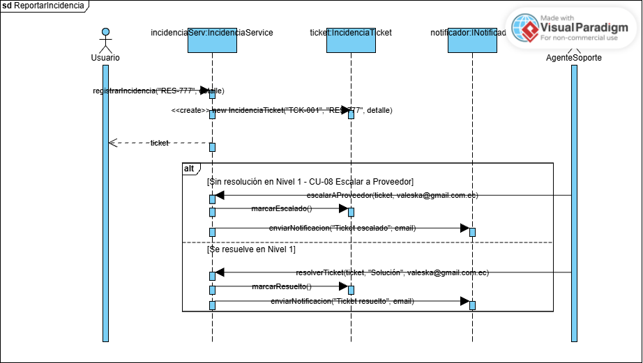
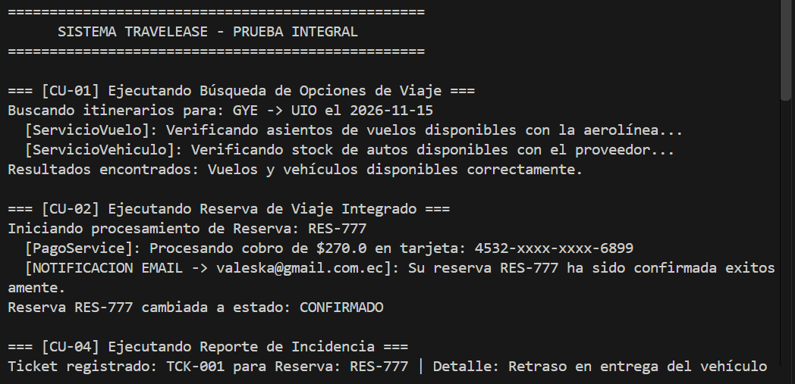

# Tarea01---SOLID_UML-Grupo-7-travelease-system-

# ✈️ TravelEase - Sistema de Gestión de Viajes Integrados

Este repositorio contiene la implementación en Java y la documentación UML del sistema **TravelEase**, desarrollado mediante programación orientada a objetos, aplicación de los principios **SOLID** y el patrón de diseño **Abstract Factory**.

---

## 👥 Integrantes del Equipo

- **Andrés Martínez Gutiérrez** - Integrante 1
- **Roy Real** - Integrante 2
- **Valeska Urrutia** - Integrante 3

---

## 🚀 Descripción del Proyecto

TravelEase es una plataforma modular para la gestión de viajes integrados. El sistema permite buscar opciones de vuelos y vehículos, realizar reservas, procesar pagos, gestionar cancelaciones y reembolsos, agregar servicios adicionales y registrar incidencias que pueden resolverse internamente o escalarse a un proveedor externo.

El proyecto fue estructurado mediante clases de dominio, servicios e interfaces con el objetivo de disminuir el acoplamiento entre componentes y facilitar su extensión y mantenimiento.

---

## 📌 Casos de Uso Principales

Los cuatro casos de uso desarrollados y representados mediante diagramas de secuencia son:

1. **CU-01 Buscar Opciones de Viaje**
2. **CU-02 Reservar Viaje Integrado**
3. **CU-03 Gestionar Cancelación y Reembolso**
4. **CU-04 Reportar Incidencia**

También se utilizaron los siguientes casos relacionados:

- **CU-05 Verificar disponibilidad**
- **CU-06 Procesar pago**
- **CU-07 Agregar servicios adicionales**
- **CU-08 Escalar a Proveedor**

---

## 📂 Estructura del Código Source (`src`)

```text
src/
└── com/
    └── travelease/
        ├── enums/                  # Enumeraciones y seguridad de tipos
        │   ├── EstadoBoleto.java
        │   ├── EstadoReserva.java
        │   ├── EstadoTicket.java
        │   └── EstadoVehiculo.java
        │
        ├── model/                  # Modelo de dominio
        │   ├── AlquilerVehiculo.java
        │   ├── Boleto.java
        │   ├── CoberturaExtendida.java
        │   ├── IncidenciaTicket.java
        │   ├── Reserva.java
        │   ├── SeguroViaje.java
        │   ├── ServicioAdicional.java
        │   ├── Usuario.java
        │   ├── Vehiculo.java
        │   └── Vuelo.java
        │
        ├── service/                # Servicios, interfaces y abstracciones
        │   ├── BusquedaService.java
        │   ├── INotificador.java
        │   ├── IProveedorFactory.java
        │   ├── IServicioProveedor.java
        │   ├── IncidenciaService.java
        │   ├── NotificacionEmailService.java
        │   ├── PagoService.java
        │   ├── ProveedorFactory.java
        │   ├── ReservaService.java
        │   ├── ServicioVehiculo.java
        │   └── ServicioVuelo.java
        │
        └── Main.java               # Ejecución integral de los casos de uso
```

---

## 🏭 Patrón Abstract Factory

TravelEase utiliza el patrón **Abstract Factory** para desacoplar la creación de los servicios relacionados con los proveedores de vuelos y vehículos.

La interfaz:

`IProveedorFactory`

define las operaciones necesarias para crear servicios de proveedores.

La implementación:

`ProveedorFactory`

se encarga de crear:

- `ServicioVuelo`
- `ServicioVehiculo`

Ambos servicios implementan:

`IServicioProveedor`

De esta manera, `BusquedaService` trabaja con abstracciones en lugar de depender directamente de clases concretas.

---

## 🧩 Aplicación de Principios SOLID

### S - Single Responsibility Principle

Las clases poseen responsabilidades específicas.

Ejemplos:

- `BusquedaService` gestiona búsquedas.
- `PagoService` procesa pagos y reembolsos.
- `ReservaService` gestiona reservas.
- `IncidenciaService` administra incidencias.
- `NotificacionEmailService` realiza notificaciones.

### O - Open/Closed Principle

El sistema puede extenderse mediante nuevas implementaciones de interfaces sin modificar el comportamiento central existente.

### L - Liskov Substitution Principle

Las implementaciones de `IServicioProveedor` pueden utilizarse mediante su abstracción sin alterar el funcionamiento esperado del sistema.

### I - Interface Segregation Principle

Se utilizan interfaces específicas como:

- `INotificador`
- `IServicioProveedor`
- `IProveedorFactory`

evitando dependencias innecesarias.

### D - Dependency Inversion Principle

Los servicios principales dependen de abstracciones.

Por ejemplo, `BusquedaService` utiliza `IProveedorFactory` e `IServicioProveedor`, mientras que otros componentes utilizan `INotificador`.

---

## 🔄 Diagramas de Secuencia

### CU-01 Buscar Opciones de Viaje

**Diagrama:** `sd BuscarOpcionesDeViaje`

Participantes principales:

- Usuario
- `busquedaServ:BusquedaService`
- `vueloServ:IServicioProveedor`
- `vehiculoServ:IServicioProveedor`

Incluye:

**CU-05 Verificar disponibilidad**



---

### CU-02 Reservar Viaje Integrado

**Diagrama:** `sd ReservarViajeIntegrado`

Participantes principales:

- Usuario
- `reservaServ:ReservaService`
- `reserva:Reserva`
- `pagoServ:PagoService`
- `usuario:Usuario`
- `notificador:INotificador`

Incluye:

- Punto de extensión **CU-07 Agregar servicios adicionales**
- **CU-06 Procesar pago**



---

### CU-03 Gestionar Cancelación y Reembolso

**Diagrama:** `sd GestionarCancelacionYReembolso`

El flujo contempla:

- Validación del estado de la reserva
- Cancelación
- Emisión del reembolso
- Obtención de los datos del usuario
- Envío de la notificación de cancelación



---

### CU-04 Reportar Incidencia

**Diagrama:** `sd ReportarIncidencia`

El caso contempla dos flujos alternativos:

- Escalamiento del ticket al proveedor cuando no existe resolución en Nivel 1.
- Resolución del ticket en Nivel 1.

También se representa la creación del objeto `IncidenciaTicket` y el envío de las respectivas notificaciones.



---

## 📸 Evidencias de Aportes por Integrante

### Integrante 1 - Andrés Martínez Gutiérrez

Participación en la implementación, integración y estructura general del proyecto TravelEase.


---

### Integrante 2 - Roy Real

Participación en modelos, enumeraciones y componentes relacionados con vehículos y servicios del sistema.

---

### Integrante 3 - Valeska Urrutia

Aportes realizados:

- Implementación de `IncidenciaService.java`
- Implementación de `IServicioProveedor.java`
- Implementación de `PagoService.java`
- Implementación de `ServicioVehiculo.java`
- Implementación de `ServicioVuelo.java`
- Implementación de `IProveedorFactory.java`
- Implementación de `ProveedorFactory.java`
- Actualización de `BusquedaService.java` para utilizar Abstract Factory
- Actualización de `Main.java`
- Elaboración del diagrama de secuencia **CU-01 Buscar Opciones de Viaje**
- Elaboración del diagrama de secuencia **CU-02 Reservar Viaje Integrado**
- Elaboración del diagrama de secuencia **CU-03 Gestionar Cancelación y Reembolso**
- Elaboración del diagrama de secuencia **CU-04 Reportar Incidencia**
- Participación mediante commits y Pull Requests en la rama `feature/integrante-3`

---

## ▶️ Ejecución

La clase `Main.java` realiza una prueba integral de los principales casos de uso del sistema:

1. Búsqueda de opciones de viaje.
2. Reserva integrada y procesamiento de pago.
3. Reporte y escalamiento de incidencia.
4. Cancelación y emisión de reembolso.

---

## 🛠️ Tecnologías Utilizadas

- Java
- Git
- GitHub
- Visual Paradigm
- UML
- Programación Orientada a Objetos
- Principios SOLID
- Patrón Abstract Factory

---

## 📚 Documentación UML

La documentación del proyecto incluye:

- Diagrama de Casos de Uso
- Diagrama de Clases
- Diagramas de Secuencia
- Especificación de Casos de Uso
- Justificación de los principios SOLID
- Aplicación del patrón Abstract Factory
